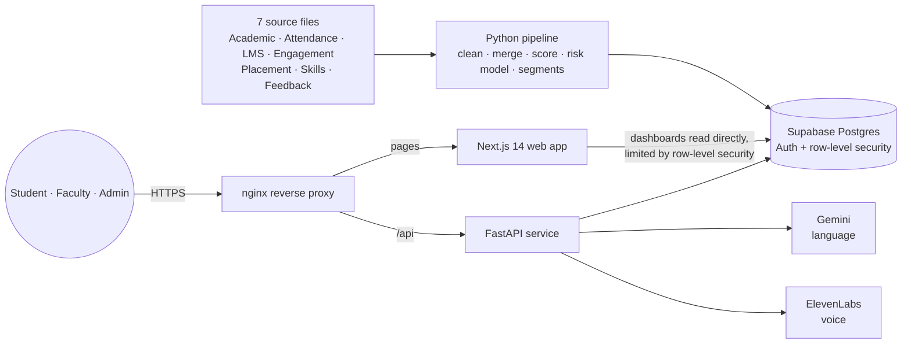
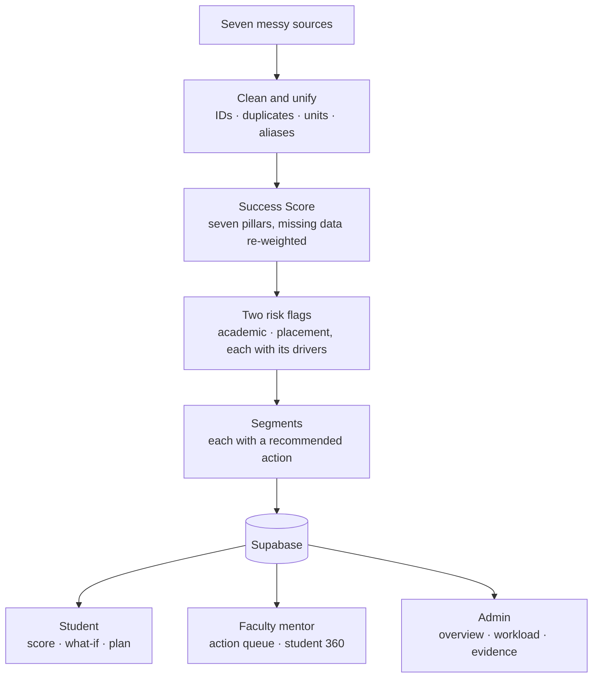
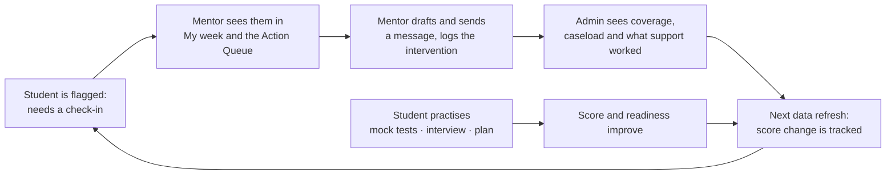

# Elevra.ai: Smart Campus Analytics

**KPMG in India challenge: Smart Campus Analytics, Predict, Optimize & Improve Student Success** · HacXLerate 2026, Round 1

Elevra.ai merges seven student data sources into one view, scores every student, flags who needs a check-in and why,
and helps faculty and administrators act on it and see whether they are acting. Students get their own score, a
what-if simulator and a path to improve.

| | |
|---|---|
| Live app | https://elevra.engimind.cloud |
| API | https://elevra.engimind.cloud/api/health (FastAPI) |
| Score method | In the app: **Method & Trust** (model card, back-test, fairness) |
| Slides / demo video | SLIDES_URL · VIDEO_URL (to be filled in) |

There is no self sign-up: administrators create every login (Admin → Users) and assign mentors. Evaluator login details are shared separately with the submission.

## How it maps to the brief

| Requirement | Where it is |
|---|---|
| **Data integration** from Academic, Attendance, LMS, Engagement, Placement, Skills, Feedback | Seven deliberately messy CSVs in `data/raw/` are cleaned (IDs, duplicates, units, aliases) by `pipeline/clean/` into one row per student, `student_unified_view`. **Data Health** page shows every fix per source. |
| **Student Success Score** from academic and engagement indicators | Seven pillars with fixed weights, missing pillars re-weighted, shown on the overview, queue and every profile. See the score note. |
| **At-risk identification**: academic and placement | Two separate Green/Amber/Red flags. Academic risk blends transparent rules with a logistic-regression early-warning model; placement risk is rule-based (there are no real placement outcomes to train on). A "declining" marker flags score drops. |
| **Interactive dashboard** for faculty and admins | Admin overview (filters by department, year, batch; heat-map; risk scatter), faculty Action Queue, Student 360. |
| **Bonus: segmentation** | Named segments with a recommended action each (`/insights/segments`). |
| **Bonus: explainable score** | Per-student waterfall of pillar contributions, plus plain-language drivers for each risk flag. |
| **Method & Trust** | Model card: AUC, back-test against a plain attendance rule, lead-time evidence, fairness by group. |

### Beyond the brief: closing the loop

Flagging a student is not enough, so the product tracks what happens next.

- **My week** (faculty): how many Red mentees were contacted in the last 7 days, a short "start with these 5" list, follow-ups with a one-click Done, and a *Last contact* column.
- **Response & workload** (admin): coverage of Red students, per-mentor caseload, rebalancing suggestions applied in one click, and a bulk "check-in" task.
- **Intervention effectiveness**: score change after each type of support (association, not proof of cause).
- **Attendance recovery planner**: classes still needed per student to finish the term at the required attendance, with an editable policy, CSV and a printable notice list.
- **Message drafts**: a check-in, guardian attendance note, placement nudge or encouragement; the mentor edits and sends it. Nothing is sent from the app.
- **Accreditation evidence**: NAAC-style tables of slow and advanced learners, mentor allocation and support given, with CSV and print.
- **Weekly brief**: a short written summary for the dean on the Overview.
- **Ask Elevra assistant**: one floating chat window for every role. Students ask about their own score and plan; faculty and admins ask questions in plain English and get a read-only, allow-listed query with the result, a chart and a link to the right page.
- **Student side**: what-if simulator, improvement path, certifications, hackathons, notifications and a mock interview with a spoken interviewer.
- **Practice and recognition**: daily challenges and timed mock tests (aptitude, coding, SQL, C++, MCQ), a login streak, achievement badges and a coin balance that can be redeemed in a small rewards store.

Language is deliberately careful: a flag means **"needs a check-in"**, never "will fail", and nobody is described with a guessed pronoun.

## Responsible AI and reliability

- Every AI feature has a non-AI fallback and shows an *offline* state; the dashboards read Supabase directly and keep working if the API is down.
- AI text (briefs, messages, weekly summary) is accepted only if it passes a fact check: every figure must come from the data, no failure predictions, no gendered pronouns, length limit. Otherwise a standard text is shown and labelled as such.
- Row-level security in Postgres: a student reads only their own rows, a mentor only their mentees, an admin everything. Verified with 59 automated checks (`db/tests/run_rls_test.py`).
- Seeded interventions are labelled as synthetic demonstration data and excluded from the live support figures.

## Architecture



| Layer | What it does |
|---|---|
| **Data pipeline** (`pipeline/`) | Generates and cleans the seven messy sources, resolves student IDs, merges them into one row per student, computes the Success Score and both risk flags, and writes everything to Supabase. |
| **Database** (Supabase Postgres) | Single source of truth. Auth issues each user a role; row-level security means a student reads only their own rows, a mentor only their mentees, an admin everything. |
| **Web app** (Next.js 14) | Role-based dashboards for admin, faculty and student. Reads data straight from Supabase, so dashboards keep working if the API is down. |
| **API** (FastAPI) | Everything that needs a server secret or computation: what-if scoring, the mock interview and voice, the Ask Elevra assistant, mentor briefs, tests and rewards, user administration. |
| **AI services** | Gemini for language, ElevenLabs for the interviewer's voice. Every AI feature has a non-AI fallback. |
| **Hosting** | The web app and API run behind one nginx reverse proxy on a single HTTPS domain, with the API under `/api`. |

Stack: Next.js 14 (App Router) · TypeScript · Tailwind · shadcn/ui · Recharts · Supabase (Postgres + Auth) · FastAPI · pandas / scikit-learn · Gemini · ElevenLabs.
One scoring engine (`pipeline/scoring/engine.py`) is used by both the batch job and the what-if API, so they cannot disagree.

## Workflow

**From raw data to a decision**



**Closing the loop: what happens after a flag**



1. **Ingest and score.** The pipeline cleans the sources, builds the unified student view and scores every student.
2. **Flag and explain.** Each student gets an academic and a placement flag, with the drivers behind it.
3. **Act.** Faculty work through a prioritised queue, draft a message and log what they did. Students follow their own improvement path, take timed tests and practise interviews.
4. **Oversee.** Admins see whether flagged students are being reached, how workload is spread, and which kinds of support are followed by score gains.
5. **Repeat.** New data flows in, scores update, and the cycle continues.

## Run it locally

Prerequisites: Node 22+, Python 3.11+, a Supabase project, and a Gemini API key (optional: every AI feature falls back without it). On Windows use `;` instead of `:` in `PYTHONPATH`.

```bash
# 0. configuration: copy .env.example to .env (read by the API) and to .env.local (read by the data loader, same
#    values), and put only the NEXT_PUBLIC_* lines in frontend/.env.local. All are git-ignored. Never commit them.

# 1. database: run every file in db/migrations/ (001 to 009) in order in the Supabase SQL editor. 001 and 002 are
#    the schema and row-level security; 003 and 004 power interview coaching and saved chats; 005 to 009 power
#    daily challenges, timed tests, the coin balance and the rewards store

# 2. Python dependencies (shared by the API and the pipeline)
pip install -r backend/requirements.txt

# 3. data: generate the seven messy sources, clean, score, and load 1,500 students plus the demo logins.
#    The random seed is fixed, so everyone gets the same data. Add --no-db to write local files only.
python pipeline/run.py --regenerate

# 4. API. On Windows just run  .\run-api.ps1 from the repository root (it creates the environment, installs
#    dependencies and starts the server on port 8000). Elsewhere:
#    (PYTHONPATH must include pipeline/, because the what-if endpoint imports the scoring engine)
cd backend && PYTHONPATH=../pipeline:. uvicorn main:app --port 8000      # http://localhost:8000/health

# 5. web app
cd frontend && npm install && npm run dev                               # http://localhost:3000
```

Tests: `cd frontend && npm test` · `cd backend && python -m unittest discover -s tests -t .` · `pytest pipeline/tests`.

### Deploying

The web app and API run on one VPS behind an nginx reverse proxy on a single HTTPS domain (the API is served under `/api`). HTTPS is required, because the voice interview needs the microphone. Ready-made service and nginx files are in `deploy/`. After deploying, run `python deploy/smoke_test.py WEB_URL API_URL`; every line must say PASS.

### Environment variables (names only)

`NEXT_PUBLIC_SUPABASE_URL`, `NEXT_PUBLIC_SUPABASE_ANON_KEY`, `NEXT_PUBLIC_API_URL`, `NEXT_PUBLIC_DEMO_PASSWORD` (web) ·
`SUPABASE_URL`, `SUPABASE_SERVICE_ROLE_KEY`, `SUPABASE_DB_URL`, `GEMINI_API_KEY`, `GEMINI_MODEL`,
`ELEVENLABS_API_KEY`, `ELEVENLABS_VOICE_ID`, `ELEVENLABS_MODEL`, `ALLOWED_ORIGINS`, `DEMO_PASSWORD` (API and pipeline).
The service-role key is server-only and must never reach the browser.

## Repository layout

```
frontend/   Next.js app: app/{admin,faculty,student,insights,demo,login}, components/, lib/
backend/    FastAPI: routers/{admin,faculty,student,assistant,briefs,chat,daily_tests,weekly,whatif,interview,tts}, common/, tests/
pipeline/   generate/, clean/, scoring/ (engine + model), run.py, seed.py, tests/
db/         migrations (schema, row-level security) and tests/ (the row-level security test)
deploy/     systemd and nginx files, plus a post-deploy smoke test
data/raw/   the seven messy source files plus faculty
```

## Honest limits

- All data is synthetic; planted patterns (for example attendance driving backlogs) exist so the analytics have something real to find.
- Placement risk is rule-based because there are no real placement outcomes to learn from.
- Intervention "effects" are associations in synthetic history, not causal estimates.
- A risk flag is a prompt for a conversation with a student, not a judgement.


